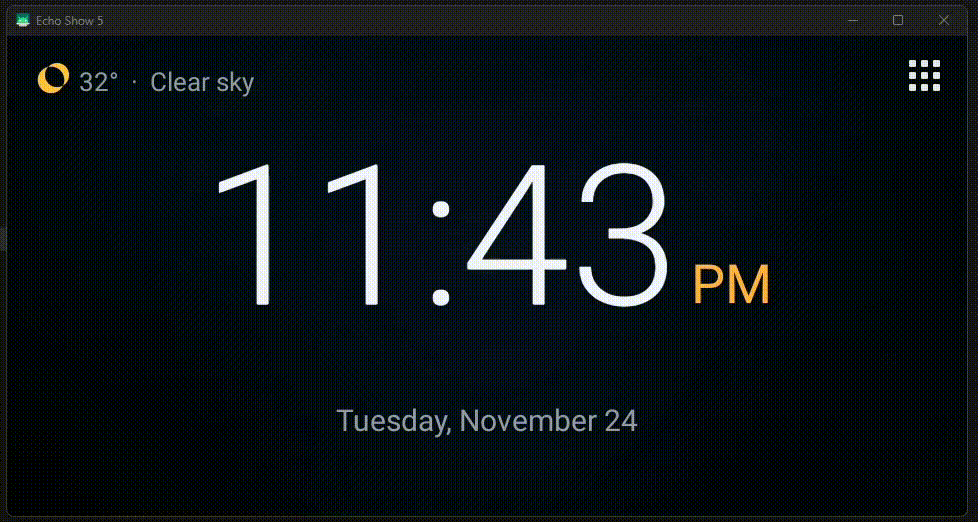

# Echo Show Launcher

A launcher for the Echo Show 5 (960x480, Android 11) with the original Echo
Show home screen plus a KFTV-style applications menu.

## Features

- **Home screen** — original Echo Show look: large clock with AM/PM, live
  weather, date, abstract teal orb wallpaper, and a music mini-strip
- **Applications menu** — KFTV menu style with real app icons and gray app names
  in a freely scrolling horizontal row. Open with the grid icon at top-right.
- **Night overlay** — in near-total darkness (below 0.8 lux) the current screen
  fades to pure black with a red clock/date; tap to wake, and it clears above
  1.5 lux. It is an overlay on any screen, not a separate activity.
- **Auto brightness** — ambient light sensor drives window brightness smoothly;
  a manual system brightness change stops automatic control. Long-press the
  clock to re-enable auto.
- **Live weather** — Open-Meteo (with wttr.in fallback), IP-based location,
  cached offline with a 10-minute refresh.
- **Music player** — preset internet radio (NCS Radio, SomaFM) plus local audio;
  transport controls, seek bar, track list, and a mini-player on the home screen.
- **Animations** — intro fades, ambient glow, rotating sun rays, weather glyphs,
  minute-rollover fade, and animated activity transitions.

## Preview



## Files

- `EchoShowLauncher.apk` — signed, installable APK
- `build.ps1` — rebuild script (aapt2 + javac + d8 + apksigner)
- `src/`, `res/`, `AndroidManifest.xml` — sources

## Build & install

```powershell
powershell -NoProfile -ExecutionPolicy Bypass -File .\build.ps1
adb install -r .\EchoShowLauncher.apk
adb shell cmd package set-home-activity com.echoshow.launcher/.HomeActivity
adb shell am start -a android.intent.action.MAIN -c android.intent.category.HOME
```

Permissions: `INTERNET` for weather/radio, `READ_EXTERNAL_STORAGE` for local music.
