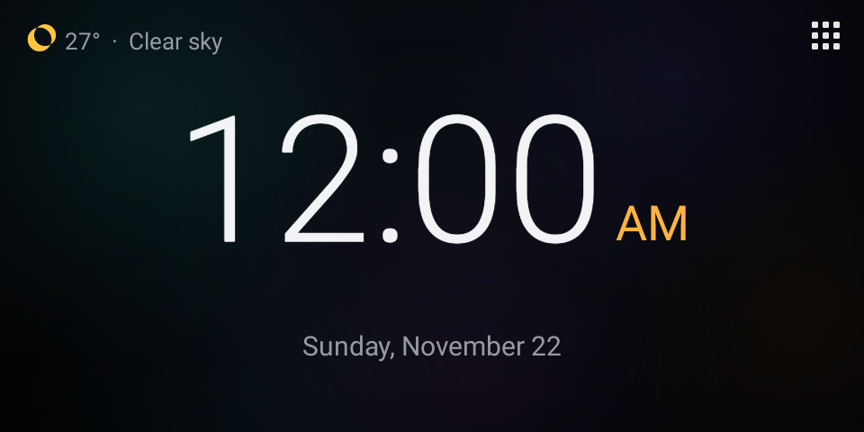
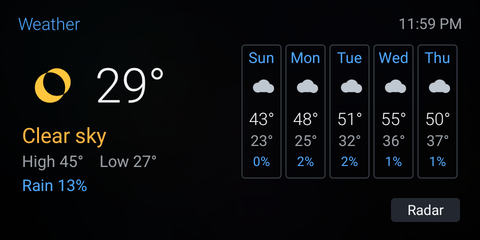
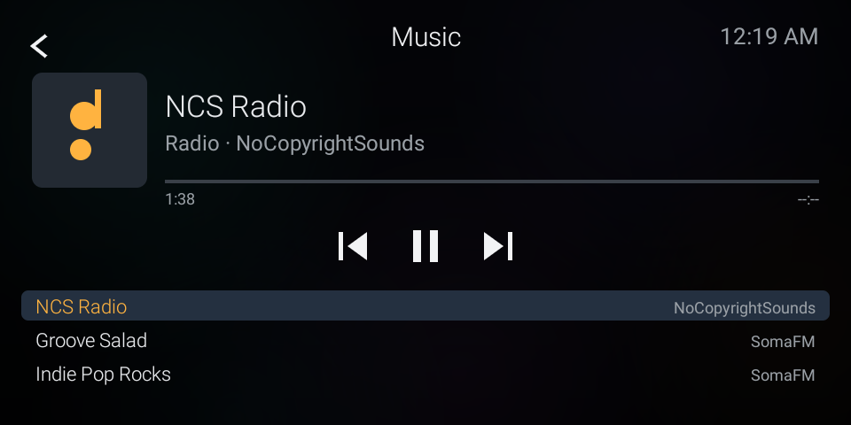
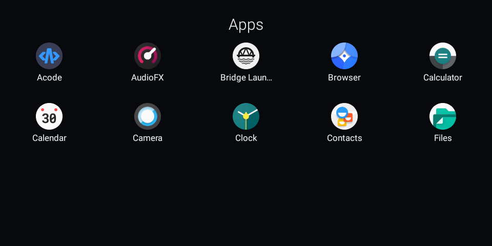

# Echo Show Launcher

A launcher for the Echo Show 5 (960x480, Android 11) that recreates the stock
Echo Show home screen: a large clock, live weather, date and an abstract
wallpaper on a dark background.

## Features

- **Home screen** — big clock with AM/PM, date, live weather widget, wallpaper
- **Live weather** — Open-Meteo (with automatic wttr.in fallback), device IP location,
  cached offline with a 10-minute refresh
- **Weather screen** — tap the weather widget for current conditions and a 5-day forecast
- **Auto brightness** — uses the ambient light sensor; long-press the clock to toggle
- **Music player** — tap the note icon at bottom-left. Includes preset internet radio
  (**NCS Radio**, SomaFM Groove Salad, SomaFM Indie Pop Rocks) plus local audio files
  after granting media access. Play/pause, next/previous, seek and track list.
  A mini-player strip appears on the home screen while playing.
- **App drawer** — tap the grid icon in the top-right, or swipe up, to see installed apps
- **Animations** — intro fade/slide, breathing glow, rotating sun rays, weather icons,
  minute-rollover fade, animated drawer and activity transitions

## Screenshots

| Home | Weather |
| --- | --- |
|  |  |

| Music | App drawer |
| --- | --- |
|  |  |

## Files

- `EchoShowLauncher.apk` — signed, installable APK
- `build.ps1` — rebuild script (aapt2 + javac + d8 + apksigner)
- `src/`, `res/`, `AndroidManifest.xml` — sources

## Build & install

```powershell
powershell -NoProfile -ExecutionPolicy Bypass -File .\EchoShowLauncher\build.ps1
adb install -r .\EchoShowLauncher\EchoShowLauncher.apk
adb shell cmd package set-home-activity com.echoshow.launcher/.HomeActivity
adb shell am start -a android.intent.action.MAIN -c android.intent.category.HOME
```

Permissions: `INTERNET` for weather/radio, `READ_EXTERNAL_STORAGE` for local music
(requested on first open of the music screen).
